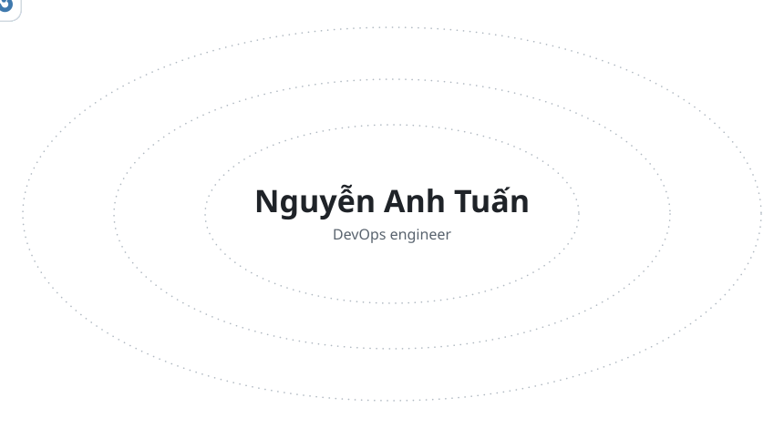

<picture>
  <source media="(prefers-color-scheme: dark)" srcset="./profile/orbit-dark.svg">
  
</picture>

A mercenary DevOps

 

<picture>
  <source media="(prefers-color-scheme: dark)" srcset="https://raw.githubusercontent.com/AnhTuan2111/AnhTuan2111/output/github-snake-dark.svg">
  
</picture>

